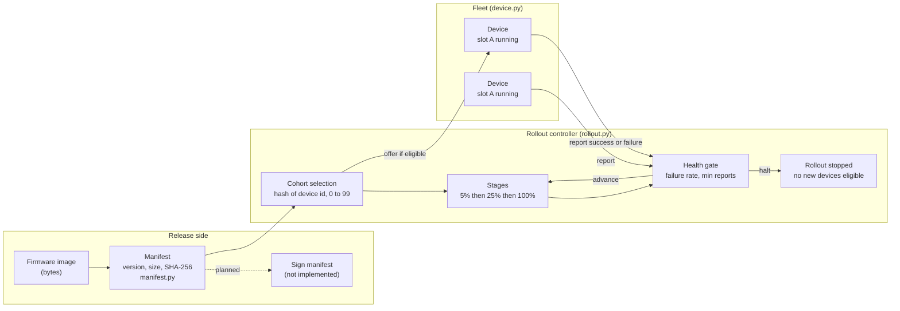
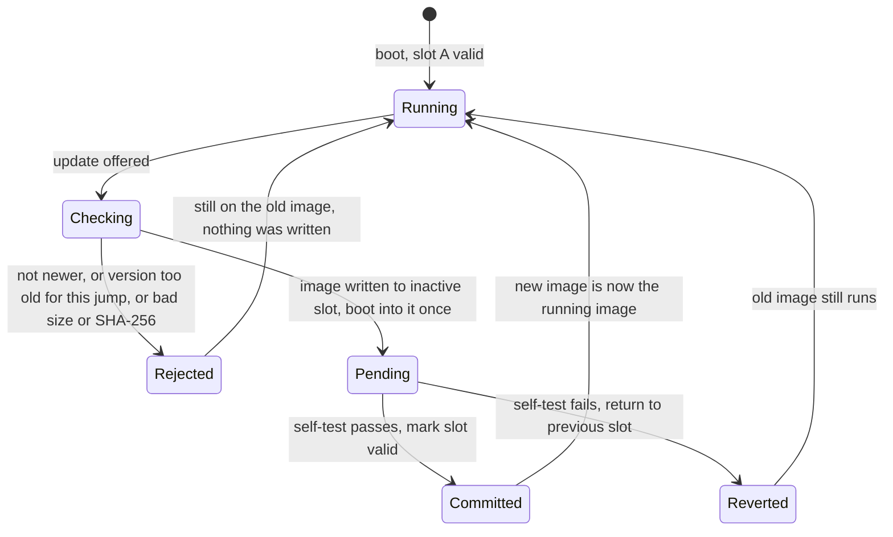
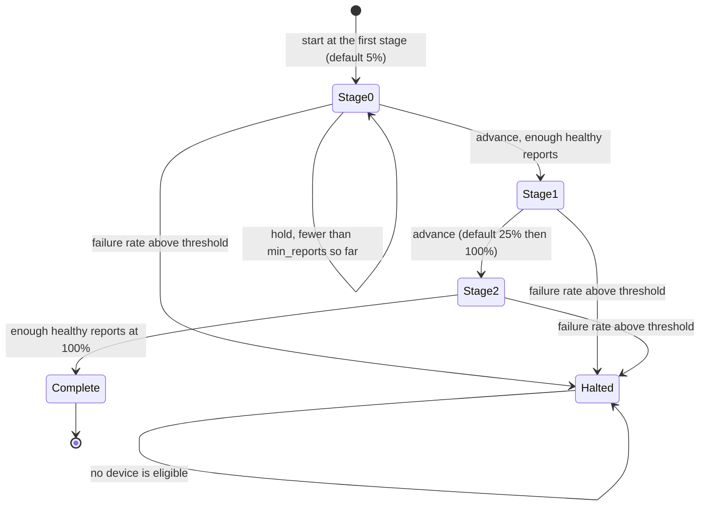
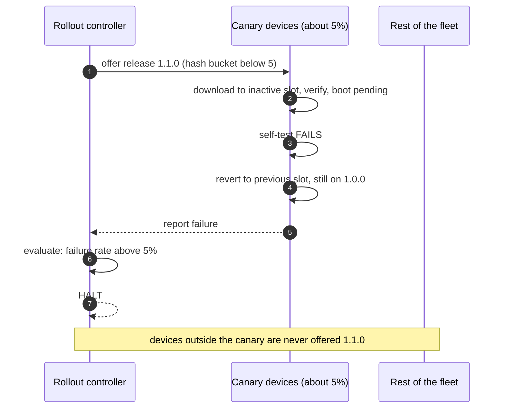

# esp32-ota-rollout

[](https://github.com/sunusr143/esp32-ota-rollout/actions/workflows/ci.yml)

The **release side** of over-the-air (OTA) firmware updates for a fleet of ESP32-class devices. It models three things and tests all of them:

1. a **manifest** that describes a firmware image (version, size, SHA-256) so a device can tell whether a download is intact;
2. a **dual-slot device** that updates into its inactive partition, boots the new image once, runs a self-test, and either commits or reverts on its own;
3. a **staged rollout controller** that offers a release to a small canary group first, advances only when enough of them report healthy, and halts the whole rollout when too many fail.

Shipping a bad firmware build to devices you cannot physically reach is one of the most expensive mistakes in embedded work. This project is about the logic that prevents it, written in plain Python so it can be tested and simulated without hardware.

> **Scope, stated up front.** This is a behavioural model and a simulator of the release process. It is **not** ESP32 firmware, it does **not** talk to real devices, and it does **not** implement cryptographic signing. See [Status](#status-what-is-verified-and-what-is-not) and [Mapping to a real ESP32](#mapping-to-a-real-esp32).

- [Status: what is verified and what is not](#status-what-is-verified-and-what-is-not)
- [Architecture](#architecture)
- [Quick start](#quick-start)
- [How it works](#how-it-works)
- [Using the library](#using-the-library)
- [Worked scenarios](#worked-scenarios)
- [Mapping to a real ESP32](#mapping-to-a-real-esp32)
- [Security model](#security-model)
- [Testing](#testing)
- [Design decisions and trade-offs](#design-decisions-and-trade-offs)
- [Limitations and roadmap](#limitations-and-roadmap)
- [Repository layout](#repository-layout)

---

## Status: what is verified and what is not

| Area | Status |
|---|---|
| Manifest build and verification (size and SHA-256), including tamper detection | **Unit tested** |
| Dual-slot update: commit on success, automatic revert on failed self-test, rejection of corrupt images, downgrades and unsafe version jumps | **Unit tested** |
| Rollout controller: stable cohorts, nested stages, hold, advance, halt, configuration validation | **Unit tested** |
| Fleet simulation of a good and a bad release | **Runs** with no hardware (`python -m ota_rollout.simulate`) |
| **Authenticity** (cryptographic signature over the manifest) | **Not implemented.** Only integrity (SHA-256) is checked. See [Security model](#security-model) |
| Real ESP32 OTA (`esp_https_ota`, partition table, bootloader rollback) | **Not implemented, not tested.** See [Mapping to a real ESP32](#mapping-to-a-real-esp32) |
| Transport, device registry, real health telemetry | **Not implemented.** In the simulator a device's success or failure is reported directly |
| Time-based soak between stages | **Not implemented.** See [Limitations](#limitations-and-roadmap) |

13 unit tests pass. No field results are claimed.

---

## Architecture

### The release flow



The controller never pushes firmware; it only decides **which devices are currently allowed to take the update** and **whether the rollout may widen**. Devices decide for themselves whether an update is safe (integrity, version rules, self-test). That split matters: a halted rollout stops new devices from starting, and devices that already failed have already reverted without waiting for anyone.

### Device update lifecycle

A device has two firmware slots, like an ESP32 using two OTA partitions. The slot it is running is never written during an update.



The three outcomes a caller can see are `updated`, `rolled_back` and `rejected:<reason>`. In every case the device ends on a **bootable** image.

### Rollout controller stages



### A bad release, step by step



---

## Quick start

Requires Python 3.9 or newer. Standard library only; nothing to install.

```bash
git clone https://github.com/sunusr143/esp32-ota-rollout.git
cd esp32-ota-rollout

python3 -m unittest discover -s tests -t . -v      # 13 tests
python3 -m ota_rollout.simulate                    # good release reaches the whole fleet
python3 -m ota_rollout.simulate --bad              # bad release halts at the canary stage
python3 -m ota_rollout.simulate --fleet 1000       # larger fleet
```

---

## How it works

### Manifest (`ota_rollout/manifest.py`)

A manifest is a small dictionary that describes one image:

```json
{
  "version": "1.1.0",
  "size": 1500,
  "sha256": "77a47e645479f399...",
  "min_version": null
}
```

- `build_manifest(version, image, min_version=None)` computes the size and SHA-256 and validates the version strings (`major.minor.patch`).
- `verify_image(manifest, image)` raises `IntegrityError` if the size or the SHA-256 does not match. Size is checked first because it is cheap and catches truncated downloads before hashing.
- `parse_version` turns `"1.10.0"` into a tuple so versions compare numerically (`1.10.0` is newer than `1.9.9`, which string comparison would get wrong).
- `min_version` is the oldest version allowed to update directly to this release, used when a release depends on a migration performed by an earlier one.

### Device (`ota_rollout/device.py`)

`Device.apply(manifest, image, self_test)` runs these checks **in order** and stops at the first failure:

| Step | Check | On failure |
|---|---|---|
| 1 | Target version is strictly newer than the running version | `rejected:not_newer` (this blocks downgrades and re-flashing the same version) |
| 2 | Running version is at least `min_version`, if one is set | `rejected:needs_intermediate_update` |
| 3 | Image matches the manifest (size and SHA-256) | `rejected:size mismatch` or `rejected:checksum mismatch` |
| 4 | Write the image to the **inactive** slot and boot into it as *pending* | n/a |
| 5 | Run the self-test | **Revert**: return to the previous slot, clear the failed slot, outcome `rolled_back` |
| 6 | Self-test passed | **Commit**: the new version becomes the running version, outcome `updated` |

Rejections happen before anything is written, so a rejected update never touches either slot. After a successful update the slots alternate: `A` running, then `B`, then `A` again.

The self-test is a function you pass in. In real firmware it would check things like "connected to Wi-Fi and the broker, sensors respond, and the application ran for N seconds without a watchdog reset". Booting is not the same as being healthy, which is exactly why the commit waits for it.

### Rollout controller (`ota_rollout/rollout.py`)

**Cohorts.** `bucket(device_id)` hashes the id with SHA-256 and maps it to a number from 0 to 99. A device is eligible when its bucket is below the current stage percentage. Three properties follow, and each is tested:

- **Stable:** the same device always lands in the same bucket, across runs and machines.
- **Nested:** the 5% cohort is a subset of the 25% cohort, which is a subset of 100%. Widening a stage never removes a device that already updated.
- **Roughly proportional:** for the 200-device simulation the stages select 12, 53 and 200 devices (about 6%, 26% and 100%). Cohort sizes are statistical, so a small fleet can deviate noticeably from the nominal percentage.

**The health gate.** `evaluate()` looks at the reports from every device whose bucket is inside the current stage and returns one of four verdicts. The order of the checks matters:

| Order | Condition | Verdict |
|---|---|---|
| 1 | Rollout already halted | `halt` |
| 2 | Failure rate is above `max_failure_rate` and there are at least `min(min_reports, 2)` reports | `halt` (sets `halted`; nobody new is eligible) |
| 3 | Fewer than `min_reports` reports so far | `hold` (wait for more devices to report) |
| 4 | At the last stage | `complete` |
| 5 | Otherwise | `advance` (moves to the next stage) |

Halting is checked **before** holding on purpose: a canary that is clearly failing should stop the rollout as soon as two devices have reported, not after `min_reports` have. Defaults are `max_failure_rate=0.05` and `min_reports=5`.

**Configuration is validated.** Stages must be strictly increasing percentages ending at 100, and `max_failure_rate` must be in `[0, 1)`; anything else raises `ValueError` at construction.

---

## Using the library

```python
from ota_rollout.manifest import build_manifest
from ota_rollout.device import Device
from ota_rollout.rollout import RolloutController

image = b"firmware-v1.1.0" * 100
manifest = build_manifest("1.1.0", image)        # version, size, SHA-256

ctl = RolloutController(stages=[5, 25, 100], max_failure_rate=0.05, min_reports=5)

device = Device("esp32-0001")                     # running 1.0.0 in slot A
if ctl.eligible(device.device_id):                # is this device in the current cohort?
    outcome = device.apply(manifest, image, self_test=lambda d: True)
    ctl.report(device.device_id, outcome == "updated")

verdict = ctl.evaluate()                          # 'hold', 'advance', 'halt' or 'complete'
```

Expected behaviour of the individual pieces:

```python
Device("a").apply(manifest, image, self_test=lambda d: True)    # 'updated'     -> version 1.1.0, slot B running
Device("b").apply(manifest, image, self_test=lambda d: False)   # 'rolled_back' -> still 1.0.0, slot A running
Device("c").apply(manifest, b"corrupt")                         # 'rejected:size mismatch'
```

The controller is deliberately passive: **you** call `eligible`, `report` and `evaluate`. That keeps it easy to drive from a script, a scheduler, a Lambda, or a test.

---

## Worked scenarios

Both runs use a 200-device fleet and the default controller settings.

### A healthy release

```text
$ python3 -m ota_rollout.simulate
round 1: stage=  5% reports= 12 updated= 12 -> advance
round 2: stage= 25% reports= 53 updated= 53 -> advance
round 3: stage=100% reports=200 updated=200 -> complete
result: 200/200 on 1.1.0, 0 still on 1.0.0, halted=False
```

12 devices (the 5% cohort) update and report healthy, so the rollout advances. The 25% stage brings the total to 53 devices, then everyone.

### A bad release

```text
$ python3 -m ota_rollout.simulate --bad
round 1: stage=  5% reports= 12 updated=  0 -> halt
result: 0/200 on 1.1.0, 200 still on 1.0.0, halted=True
```

In this run the release fails its post-boot self-test everywhere it is tried. The 12 canary devices each wrote the image, booted it, failed the test and **reverted by themselves**. The controller then saw a 100% failure rate and halted. The other 188 devices were never offered the update, and all 200 devices are still running a working 1.0.0. That is the whole point of the design: a bad release costs 12 devices a brief detour instead of bricking the fleet.

### What the unit tests also cover

| Situation | Result |
|---|---|
| Image corrupted in transit | `rejected:` with a size or checksum reason; running slot untouched |
| Offered an older version (rollback attack, or a mistake) | `rejected:not_newer` |
| Offered the version it already runs | `rejected:not_newer` |
| Release requires `min_version=1.5.0` but the device runs 1.0.0 | `rejected:needs_intermediate_update` |
| Two updates in a row | Slots alternate, version advances each time |
| One failure among very few reports | Rollout holds or halts according to the order of checks above |

---

## Mapping to a real ESP32

The model is intentionally shaped like ESP-IDF's OTA support. This table maps each part to the real mechanism. **None of the right-hand column is implemented in this repository**; it is the intended next step and a pointer for where to look.

| This repository | On a real ESP32 (ESP-IDF) |
|---|---|
| Two slots `A` and `B` | A partition table with `ota_0` and `ota_1` app partitions and an `otadata` partition recording which is active |
| Write to the inactive slot | `esp_https_ota` (or `esp_ota_begin`, `esp_ota_write`, `esp_ota_end`) writes to the next OTA partition |
| Boot once as *pending* | `esp_ota_set_boot_partition`; with `CONFIG_BOOTLOADER_APP_ROLLBACK_ENABLE` the new image boots in a "pending verify" state |
| Self-test passes, commit | The application calls `esp_ota_mark_app_valid_cancel_rollback()` |
| Self-test fails, revert | `esp_ota_mark_app_invalid_rollback_and_reboot()`, or a reset before the app is marked valid makes the bootloader roll back |
| Manifest SHA-256 and size check | Check the downloaded image against a manifest fetched over TLS; ESP-IDF also validates the image header and checksum |
| Authenticity (planned) | Secure Boot v2 and signed apps (`CONFIG_SECURE_SIGNED_APPS`), plus a signature over the manifest |
| Device registry and health telemetry (planned) | Devices report version and self-test result over MQTT; the controller consumes those reports |

---

## Security model

What the project protects against, and what it does not.

| Threat | Protection here | Gap |
|---|---|---|
| Corrupted or truncated download | SHA-256 and size checked before anything is written | None for accidental corruption |
| Bad release bricking the fleet | Staged rollout, health gate, automatic halt; on-device self-test and revert | Self-test quality decides how well it works |
| Downgrade to a vulnerable version | Strictly-newer rule rejects older versions | The version is only as trustworthy as the manifest (see next row) |
| **Malicious or forged firmware** | **None.** SHA-256 in a manifest proves integrity, not origin; an attacker who can replace the image can replace the manifest too | Sign the manifest (for example Ed25519) and verify with a public key baked into the device, and use ESP-IDF Secure Boot |
| Unsafe jump across incompatible versions | `min_version` forces an intermediate update | Requires the release author to set it correctly |
| Compromised release key | Not addressed | Key storage, rotation and revocation are out of scope |

The honest summary: this repository gives you **integrity and safe rollout**. It does not give you **authenticity**. Treat it as the reliability half of a secure update system, not the whole thing.

---

## Testing

```bash
python3 -m unittest discover -s tests -t . -v
```

| Test group | What it proves |
|---|---|
| Manifest | Build and verify round-trips; a changed byte is caught by the checksum; a truncated image is caught by the size check; versions compare numerically; malformed versions are rejected |
| Device | A successful update flips the running slot; a failed self-test reverts to the old slot and clears the failed one; a corrupt image is rejected with the running slot untouched; downgrades and same-version updates are rejected; `min_version` forces an intermediate update; two updates alternate slots |
| Rollout | Buckets are stable and always in 0 to 99; cohorts are nested across stages; the controller holds until enough reports then advances; failures halt the rollout and make every device ineligible; invalid configuration is rejected |

CI runs the suite on Python 3.9 and 3.12 and runs both simulations (good and bad release) on every push.

---

## Design decisions and trade-offs

**Devices decide, the controller gates.** A device protects itself with integrity, version rules and a self-test, and the controller only widens exposure. If the controller is down or halted, devices that already started still finish safely. The alternative, a controller that micromanages each device, puts the safety logic in the one place that cannot see the device's own health.

**Commit only after a self-test.** "It booted" is a weak signal; plenty of broken builds boot and then fail on Wi-Fi, a sensor, or a watchdog. Deferring the commit means a bad image costs one reboot, not a truck roll.

**Never write the running slot.** Any approach that overwrites the running image has a window where power loss leaves a device with no valid firmware. Writing to the inactive slot removes that window.

**Hash-based cohorts, not random selection.** Random selection per run would pick different devices each time and make results unreproducible. Hashing the device id gives stable, nested cohorts with no stored state, which also makes the simulator deterministic.

**A health gate on every stage.** A staged rollout without a gate is just a slow rollout. The gate is what turns "5% first" from a schedule into a safety mechanism.

**Halt is checked before hold.** If two of the first two reporting canaries have failed, waiting for five reports only exposes more devices. Failing fast costs at most a premature halt, which a human can reverse; the opposite mistake costs devices.

**Reject downgrades by default.** Allowing arbitrary downgrades makes "update to a known-vulnerable version" an attack. Intentional rollbacks should be a separate, authenticated action.

**Standard library only.** The logic is the point. Cryptography, transport and device code are real dependencies that would obscure it, and are left for the next layer.

---

## Limitations and roadmap

Known limitations:

- **No signing.** Integrity only; see [Security model](#security-model).
- **No soak time.** The controller advances as soon as enough reports exist. Because stage reports are cumulative, a stage that already has enough reports from earlier stages can advance on the very next call. Real rollouts wait (for example hours) so that slow failures, such as a memory leak, can show up before widening.
- **Failure is binary.** A report is success or failure. Real health has more dimensions (crash loops after commit, reboot counts, error rates).
- **Statistical cohorts.** Small fleets may land noticeably above or below the nominal percentage.
- **No persistence.** Controller state lives in memory; a real controller must survive restarts.
- **No real devices or transport.** The simulator calls `Device.apply` directly.

Roadmap, roughly in order of value:

1. Sign manifests with Ed25519 and verify them in the device model.
2. Add a soak time between stages and a time-bounded health window.
3. Richer health reports (post-commit crash loops, reboot counts) feeding the gate.
4. Persist controller state and make it idempotent across restarts.
5. A small ESP-IDF example application that implements the real self-test and rollback calls, tested on a board.
6. Drive the controller from MQTT device reports instead of the simulator.

---

## Repository layout

```text
esp32-ota-rollout/
├── ota_rollout/
│   ├── manifest.py     manifest build and verification, version parsing
│   ├── device.py       dual-slot device model with commit and revert
│   ├── rollout.py      cohorts, stages and the health gate
│   └── simulate.py     fleet simulation (good and bad release)
├── tests/test_ota.py   13 unit tests
└── .github/workflows/ci.yml
```
